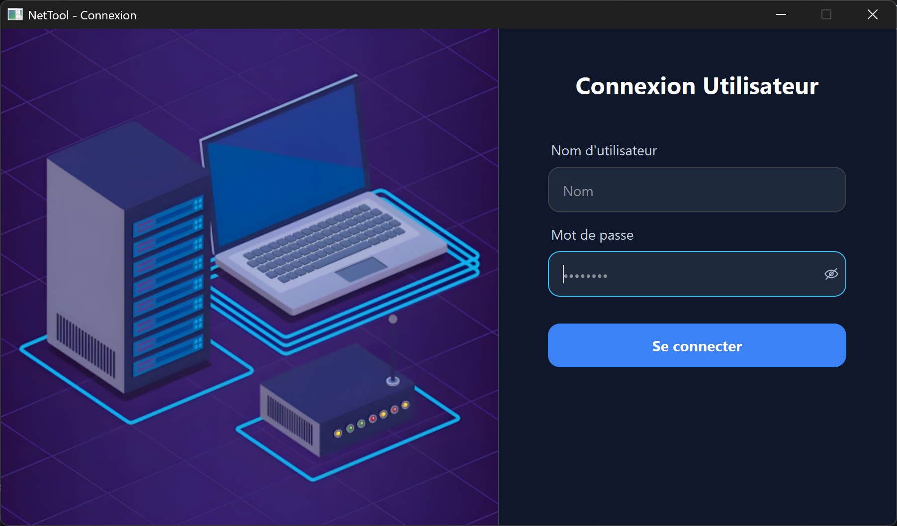
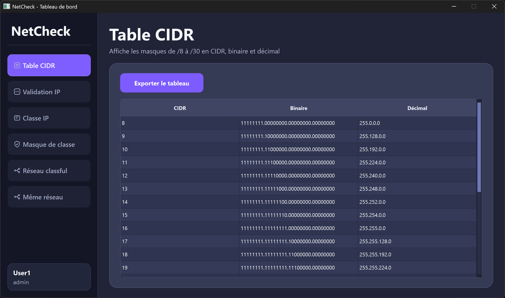
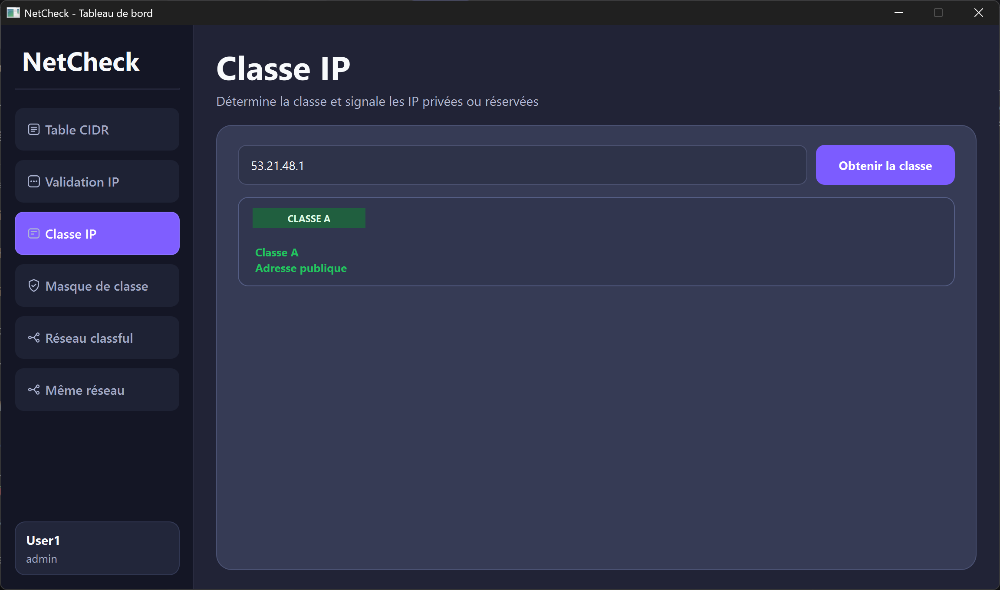
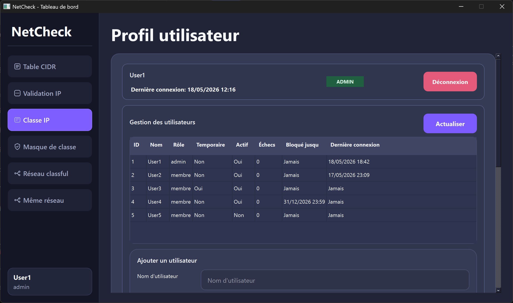

<h1 align="center">NetCheck</h1>

<a id="readme-top"></a>

<p align="center">
    
    
    
</p>

Application de bureau pour calculer rapidement des informations réseau : validation d'adresse IP, classe, masque, réseau et sous-réseau, vérification d'appartenance au même réseau et tableau CIDR.

<details>
    <summary>Table des matières</summary>
    <ol>
        <li><a href="#présentation">Présentation</a></li>
        <li><a href="#captures-décran">Captures d'écran</a></li>
        <li><a href="#installation">Installation</a></li>
        <li><a href="#configuration">Configuration</a></li>
        <li><a href="#architecture-et-technologies">Architecture et technologies</a></li>
        <li><a href="#licence">Licence</a></li>
        <li><a href="#auteur">Auteur</a></li>
    </ol>
</details>

---

## Présentation

NetCheck facilite les calculs réseau courants grâce à une interface PySide6 avec un tableau de bord à onglets et un panel d'administration pour la gestion des utilisateurs.

### Fonctionnalités

- Tableau complet des masques de /8 à /30 en notation CIDR, binaire et décimale pointée.
- Vérification du format d'une adresse IP.
- Détermination de la classe d'une IP, avec mention réservée/privée.
- Calcul du masque de classe associé à une IP.
- Détermination du réseau et du sous-réseau à partir d'une IP et de son masque (classful).
- Vérification bilatérale de l'appartenance de deux IP au même réseau.
- Panel d'administration pour générer et gérer les utilisateurs.

<p align="right">(<a href="#readme-top">retour en haut</a>)</p>

## Captures d'écran

<table>
    <tr>
        <td>
            
        </td>
        <td>
            
        </td>
    </tr>
    <tr>
        <td>
            
        </td>
        <td>
            
        </td>
    </tr>
</table>

<p align="right">(<a href="#readme-top">retour en haut</a>)</p>

## Installation

### Prérequis

- Python 3.10 ou supérieur
- [uv](https://docs.astral.sh/uv/) (recommandé)
- Docker et Docker Compose (pour la base PostgreSQL)

### Étapes

1. Cloner le dépôt :

    ```bash
    git clone https://github.com/Xen0r-star/NetCheck.git
    cd NetCheck
    ```

2. Installer les dépendances avec uv :

    ```bash
    uv sync
    ```

    <details>
        <summary>Alternative avec pip</summary>

    ```bash
    python -m venv .venv

    # Windows (PowerShell)
    .\.venv\Scripts\Activate.ps1
    # Linux / macOS
    source .venv/bin/activate

    pip install -r requirements.txt
    ```

    </details>

3. Créer le fichier de configuration `.env` (voir la section [Configuration](#configuration)).

4. Démarrer la base de données PostgreSQL :

    ```bash
    docker compose up -d
    ```

    Le schéma de la base est initialisé automatiquement à partir de `database/init.sql`.

5. Lancer l'application :

    ```bash
    uv run main.py
    ```

    Ou, avec l'alternative pip : `python main.py`.

<p align="right">(<a href="#readme-top">retour en haut</a>)</p>

## Configuration

L'application lit ses paramètres de connexion à la base de données dans un fichier `.env` placé à la racine du projet :

```env
DB_HOST=localhost
DB_NAME=NetCheck-DB
DB_USER=netcheck_user
DB_PASS=netcheck_password
DB_PORT=5432
```

Ces valeurs correspondent à celles du `docker-compose.yml` pour un usage en local. Modifiez-les si vous utilisez une autre base.

<p align="right">(<a href="#readme-top">retour en haut</a>)</p>

## Architecture et technologies

### Architecture

- **Point d'entrée** : `main.py`
- **Pages** : `src/pages/`
- **Vues** : `src/pages/views/`
- **Services** : `src/services/`
- **Styles** : `src/style/`
- **Initialisation de la base** : `database/init.sql`

### Technologies

- **Python** - Logique applicative
- **PySide6** - Interface de bureau
- **PostgreSQL** - Base de données
- **Docker Compose** - Mise en place de la base en local
- **uv** - Gestion des dépendances et de l'environnement

<p align="right">(<a href="#readme-top">retour en haut</a>)</p>

## Licence

Ce projet est distribué sous licence MIT. Consultez le fichier [LICENSE](LICENSE) pour plus de détails.

<p align="right">(<a href="#readme-top">retour en haut</a>)</p>

## Auteur

GitHub : [@Xen0r-star](https://github.com/Xen0r-star)

<p align="right">(<a href="#readme-top">retour en haut</a>)</p>
